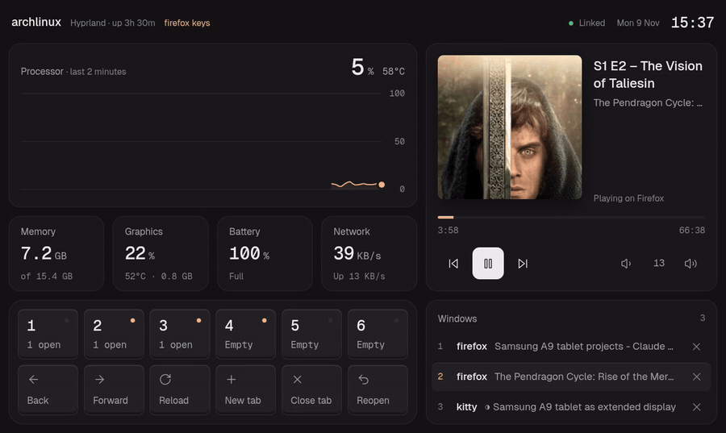

# tabdeck

Turn an Android tablet into a second monitor and a touch command center for a Hyprland desktop, over USB or Wi-Fi.



- **Extended display.** A virtual Hyprland monitor streamed with wayvnc and shown in AVNC on the tablet.
- **Command center.** A fullscreen web app on the tablet with:
  - CPU history chart and temperature
  - memory, GPU, battery and network stats
  - now playing with album art, transport and volume controls
  - workspace keys with live indicators
  - app launcher keys, and per-app key pages that follow the focused window
  - a window list where you can tap to focus a window or close it
  - long-press any key to edit it on the tablet

Everything runs on your own PC and reaches the tablet through `adb reverse`. There's no cloud, no account and no app store install.

> **Status: early.** It's tested on one setup: Arch, Hyprland with the Lua config, HyDE, an NVIDIA laptop GPU and a Samsung Galaxy Tab A9. Hardware is auto-detected, and keys and apps live in a config file. Classic Hyprland configs and AMD GPUs are supported in code but not yet tested on real machines.

## Requirements

**PC**
- Hyprland, with either the Lua config or the classic `hyprland.conf`
- `python3` (standard library only)
- `adb`, `wayvnc`
- `wpctl` (PipeWire), `playerctl`
- Optional: `qrencode` (Wi-Fi pairing), `wtype` (shortcut keys), `nvidia-smi` (NVIDIA stats), `awww` or `swww` (wallpaper copy), and whatever apps your keys launch. The default keys use `kitty`, `firefox`, `rofi` (HyDE's themed launcher when installed) and `hyprshot`

**Tablet**
- Android with USB debugging enabled
- [AVNC](https://github.com/gujjwal00/avnc) for the display
- A Chromium-based browser to install the command center as an app

## Setup

```sh
git clone https://github.com/silky-x0/tabdeck ~/tabdeck
ln -s ~/tabdeck/tablet ~/.local/bin/tablet
```

1. Plug in the tablet and accept the USB debugging prompt.
2. Run `tablet`.
3. On the tablet, open `http://127.0.0.1:8765` and choose *Install app* from the browser menu.

Every time after that, plug in the tablet, run `tablet` and open the app. To tear everything down, run `tablet stop`.

### Start automatically on plug-in

```sh
tablet install
```

This needs the tablet plugged in, and asks for sudo once. It installs:
- a udev rule that matches your tablet by serial number
- a systemd user service that runs `tablet` when the tablet is plugged in and tears everything down when it's unplugged

The service also starts at login if the tablet is already connected. To remove both, run `tablet uninstall`. Logs are in `journalctl --user -u tabdeck`.

### Wi-Fi

Pair once by scanning a QR code. The tablet and PC must be on the same network:

```sh
tablet pair
```

On the tablet, open Developer options > Wireless debugging > *Pair device with QR code* and scan the code shown in the terminal. After that:

```sh
tablet wifi
```

A background watcher checks the connection every 5 seconds. When the tablet drops off and comes back, even on a new port, it reconnects and restores the tunnels. If AVNC shows "Disconnected" afterwards, tap its retry button.

Android turns Wireless debugging off by itself after some network changes, and the watcher can't turn it back on. When that happens, switch it back on in Developer options. USB is still the more reliable option, and the lower-latency one.

## How it works

| Piece | What it does |
| --- | --- |
| `tablet` | Creates a headless Hyprland output sized to the tablet, starts `wayvnc` and the server on Unix sockets, and tunnels them to the tablet's ports 5900 and 8765 with `adb reverse` |
| `config.toml` | Keys, display placement, and hardware overrides |
| `tablet install` | Writes `/etc/udev/rules.d/70-tabdeck.rules` and `~/.config/systemd/user/tabdeck.service` |
| `tabdeck.py` | Standard-library HTTP server. It serves the page, a JSON API with stats, player and window data, the actions from your config, and the key editor |
| `tests/` | `python3 -m unittest discover -s tests`, also run by GitHub Actions |
| `static/` | The command center page, its fonts, icons and web app manifest |

## Configuration

Copy the default config and edit it:

```sh
mkdir -p ~/.config/tabdeck
cp ~/tabdeck/config.toml ~/.config/tabdeck/config.toml
```

Your copy replaces the default entirely. Restart with `tablet stop && tablet` after changes.

**Keys** are shown 6 per row, in order. Each key is either a workspace switch or a command:

```toml
[[keys]]
workspace = 1

[[keys]]
label = "Terminal"
icon = "terminal"            # a file name from static/icons (Lucide)
command = "kitty"            # a string runs with sh -c

[[keys]]
label = "Capture"
icon = "scan"
command = ["hyprshot", "-m", "region"]   # a list runs directly, no shell
```

A key can also send a keyboard shortcut to the focused window. This needs `wtype`:

```toml
[[keys]]
label = "New tab"
icon = "plus"
shortcut = "ctrl+shift+t"     # modifiers: ctrl, shift, alt, super; keys use XKB names like Left, F5, Return
```

To use another icon, drop any [Lucide](https://lucide.dev) SVG into `static/icons/`.

**Per-app pages.** When a window of a given class is focused, its page replaces the default command keys, and workspace keys stay. The header shows which page is active. The default config ships pages for `kitty` and `firefox`:

```toml
[[apps.firefox.keys]]
label = "Back"
icon = "arrow-left"
shortcut = "alt+Left"
```

To find a window's class, run `hyprctl activewindow` and look at `class`.

**Editing from the tablet.** Long-press a key to change its type, label, icon or value, delete it, or add a key after it. Changes are saved to `~/.config/tabdeck/config.toml` and apply immediately. The first edit creates that file from the active config, and comments aren't kept.

Changing a key's *command* from the tablet is off by default, because it would let anything that can reach the tablet's localhost run commands on your PC. Labels, icons, shortcuts and workspaces are always editable. To allow command editing:

```toml
[edit]
commands = true
```

**Display.** The resolution is read from the tablet over adb, and the monitor goes right of your other screens by default. Override with `display.resolution`, `display.position` (any Hyprland position, like `auto-left` or `2646x0`) and `display.scale`.

**Hardware** is auto-detected:
- network: the interface on the default route
- battery: the first `power_supply` of type Battery
- CPU temperature: `k10temp`, `zenpower`, `coretemp`, `cpu_thermal` or `acpitz`
- GPU: NVIDIA through `nvidia-smi`, AMD through sysfs

Override any of them under `[hardware]`. A card shows "Not available" or "No battery" when there's nothing to read.

## Security

- **No network ports.** The server and wayvnc listen on Unix sockets in `$XDG_RUNTIME_DIR/tabdeck`, a directory only your user can open. Other users on the PC, and web pages in a PC browser, can't reach them. `adb reverse` exposes them on the tablet's localhost.
- **Only the command center page is trusted.** Requests must carry `Host: 127.0.0.1:8765`, and writes must come from that origin, which blocks DNS rebinding and cross-site requests from web pages opened on the tablet.
- **The client never sends commands.** It sends a key id, and the server runs the matching command from your config. Window addresses, shortcuts, icons and every editor field are validated on the server.
- **Command editing is opt-in.** See [Editing from the tablet](#configuration).

What's not protected: apps installed on the tablet can reach its localhost like the browser does, so they can press keys and edit labels or shortcuts. Only install apps you trust on a tablet you connect this way, and leave `edit.commands` off unless you need it.

## Limitations

- Hyprland only. Sway, KDE and GNOME aren't supported.
- Wi-Fi depends on Android keeping Wireless debugging on, and has more display lag than USB.
- Intel GPUs don't report utilization, so the Graphics card shows "Not available".
- The display runs at a fixed 60 Hz, and the virtual monitor is always named `TAB`.

VNC sends a single pointer, so touch on the display works as mouse input. Multi-touch gestures don't reach Linux apps.

## Roadmap

- AUR package

## Credits

Built by Akhilesh Tiwari ([@silky-x0](https://github.com/silky-x0)) together with Claude, Anthropic's AI model, in Claude Code.

## License

MIT, see [LICENSE](LICENSE). Bundled third-party assets are listed in [NOTICE](NOTICE).
