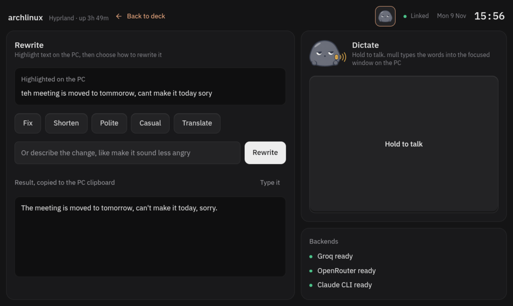

# tabdeck

Turn an Android tablet into a second monitor and a touch command center for a Hyprland desktop, over USB or Wi-Fi.


- **Extended display.** A virtual Hyprland monitor streamed with wayvnc and shown in AVNC on the tablet.
- **Command center.** A fullscreen web app on the tablet with:
  - CPU history chart and temperature
  - memory, GPU, battery and network stats
  - now playing with album art, transport and volume controls
  - workspace keys with live indicators
  - app launcher keys, and per-app key pages that follow the focused window
  - a window list where you can tap to focus a window or close it
  - long-press any key to edit it, drag it to reorder, or add a key page for the focused app
  - a [mull](https://github.com/silky-x0/mull) page: rewrite highlighted text and dictate from the tablet

Everything runs on your own PC and reaches the tablet through `adb reverse`. There's no cloud, no account and no app store install.

> **Status: early.** It's tested on one setup: Arch, Hyprland with the Lua config, HyDE, an NVIDIA laptop GPU and a Samsung Galaxy Tab A9. Hardware is auto-detected, and keys and apps live in a config file. Classic Hyprland configs and AMD GPUs are supported in code but not yet tested on real machines.

## Requirements

**PC**
- Hyprland, with either the Lua config or the classic `hyprland.conf`
- `python3` (standard library only)
- `adb`, `wayvnc`, `openssl`
- `wpctl` (PipeWire), `playerctl`
- Optional: `qrencode` (Wi-Fi pairing), `wtype` (shortcut keys), `nvidia-smi` (NVIDIA stats), `awww` or `swww` (wallpaper copy), and whatever apps your keys launch. The default keys use `kitty`, `firefox`, `rofi` (HyDE's themed launcher when installed) and `hyprshot`

**Tablet**
- Android with USB debugging enabled
- [AVNC](https://github.com/gujjwal00/avnc) for the display
- A Chromium-based browser to install the command center as an app

## Setup

```sh
git clone https://github.com/silky-x0/tabdeck ~/tabdeck
ln -s ~/tabdeck/tablet ~/.local/bin/tablet
```

1. Plug in the tablet and accept the USB debugging prompt.
2. Run `tablet`.
3. `tablet` opens the command center on the tablet. Choose *Install app* from the browser menu to keep it as an app.

Every time after that, plug in the tablet, run `tablet` and open the app. To tear everything down, run `tablet stop`.

### Start automatically on plug-in

```sh
tablet install
```

This needs the tablet plugged in, and asks for sudo once. It installs:
- a udev rule that matches your tablet by serial number
- a systemd user service that runs `tablet` when the tablet is plugged in and tears everything down when it's unplugged

The service also starts at login if the tablet is already connected. To remove both, run `tablet uninstall`. Logs are in `journalctl --user -u tabdeck`.

### Wi-Fi

Pair once by scanning a QR code. The tablet and PC must be on the same network:

```sh
tablet pair
```

On the tablet, open Developer options > Wireless debugging > *Pair device with QR code* and scan the code shown in the terminal. After that:

```sh
tablet wifi
```

To start over Wi-Fi automatically at login, run `tablet install wifi`. It waits until the tablet shows up on the network, and does nothing when the tablet is on USB, since the USB service handles that.

A background watcher checks the connection every 5 seconds. When the tablet drops off and comes back, even on a new port, it reconnects and restores the tunnels. It also reopens AVNC.

Android turns Wireless debugging off whenever Wi-Fi disconnects, even briefly, and after a reboot. This is a security measure, and the watcher can't turn it back on. To make it rarer:

- Keep Wi-Fi awake. On Samsung, open Settings > Connections > Wi-Fi > Intelligent Wi-Fi and turn off *Switch to mobile data* and any power-saving options.
- Turn on Developer options > *Stay awake*, so the screen doesn't sleep while charging.
- Turn on Developer options > *Disable adb authorization timeout*, so the pairing doesn't expire after 7 days.
- Add the *Wireless debugging* tile under Developer options > Quick settings developer tiles, so it's one tap to turn back on.
- If your router has separate 2.4 GHz and 5 GHz network names, keep the tablet on one of them.

**If the tablet shows up but won't connect, check the PC's Wi-Fi too.** If `adb mdns services` lists the tablet but `ping` to it times out, the PC's Wi-Fi card may be in power-save mode. In that mode the card keeps the PC's own connections working but misses connections that start on the tablet. Toggling the PC's Wi-Fi fixes it for a while. Check with:

```sh
iw dev wlan0 get power_save
```

Realtek cards using the `rtw89` driver (for example the RTL8852BE) are especially prone to this. To turn power saving off:

```sh
sudo iw dev wlan0 set power_save off            # until reboot

# permanently, with NetworkManager (2 = disable)
printf '[connection]\nwifi.powersave = 2\n' | sudo tee /etc/NetworkManager/conf.d/wifi-powersave-off.conf
sudo systemctl reload NetworkManager

# rtw89 only, if drops continue; applies after a reboot
echo 'options rtw89_core disable_ps_mode=y' | sudo tee /etc/modprobe.d/rtw89.conf
```

This costs a little battery on a laptop.

USB is still the more reliable option, and the lower-latency one.

## How it works

| Piece | What it does |
| --- | --- |
| `tablet` | Creates a headless Hyprland output sized to the tablet, starts `wayvnc` and the server on Unix sockets, and tunnels them to the tablet's ports 5900 and 8765 with `adb reverse` |
| `config.toml` | Keys, display placement, and hardware overrides |
| `~/.config/tabdeck/token` | The secret that unlocks the API, created on first run |
| `~/.config/tabdeck/vnc/` | The display stream's password, TLS certificate and wayvnc config, created on first run |
| `tablet phone [lan]` | Adds a listener on the Tailscale or Wi-Fi address for phones and prints a QR code to pair them |
| `tablet install` | Writes `/etc/udev/rules.d/70-tabdeck.rules` and `~/.config/systemd/user/tabdeck.service` |
| `tabdeck.py` | Standard-library HTTP server. It serves the page, a JSON API with stats, player and window data, the actions from your config, and the key editor |
| `tests/` | `python3 -m unittest discover -s tests`, also run by GitHub Actions |
| `static/` | The command center page, its fonts, icons and web app manifest |

## Configuration

Copy the default config and edit it:

```sh
mkdir -p ~/.config/tabdeck
cp ~/tabdeck/config.toml ~/.config/tabdeck/config.toml
```

Your copy replaces the default entirely. Restart with `tablet stop && tablet` after changes.

**Keys** are shown 6 per row, in order. Each key is either a workspace switch or a command:

```toml
[[keys]]
workspace = 1

[[keys]]
label = "Terminal"
icon = "terminal"            # a file name from static/icons (Lucide)
command = "kitty"            # a string runs with sh -c

[[keys]]
label = "Capture"
icon = "scan"
command = ["hyprshot", "-m", "region"]   # a list runs directly, no shell
```

A key can also send a keyboard shortcut to the focused window. This needs `wtype`:

```toml
[[keys]]
label = "New tab"
icon = "plus"
shortcut = "ctrl+shift+t"     # modifiers: ctrl, shift, alt, super; keys use XKB names like Left, F5, Return
```

To use another icon, drop any [Lucide](https://lucide.dev) SVG into `static/icons/`.

**Per-app pages.** When a window of a given class is focused, its page replaces the default command keys, and workspace keys stay. The header shows which page is active. The default config ships pages for `kitty` and `firefox`:

```toml
[[apps.firefox.keys]]
label = "Back"
icon = "arrow-left"
shortcut = "alt+Left"
```

To find a window's class, run `hyprctl activewindow` and look at `class`.

**Editing from the tablet.** Long-press a key and release to change its type, label, icon or value, delete it, or add a key after it. Long-press and drag onto another key on the same page to move it. When the focused app has no page, the header shows *Add keys for <app>*, which starts one. Changes are saved to `~/.config/tabdeck/config.toml` and apply immediately. The first edit creates that file from the active config, and comments aren't kept.

Changing a key's *command* from the tablet is off by default, because it would let anything that can reach the tablet's localhost run commands on your PC. Labels, icons, shortcuts and workspaces are always editable. To allow command editing:

```toml
[edit]
commands = true
```

**Display.** The resolution is read from the tablet over adb, and the monitor goes right of your other screens by default. Override with:
- `display.resolution`
- `display.position`: any Hyprland position, like `auto-left` or `2646x0`
- `display.scale`
- `display.refresh`: 60 by default
- `display.name`: the Hyprland output name, `TAB` by default

**Ports** on the tablet's localhost default to 8765 for the command center and 5900 for the display. If another app on the tablet uses them, change `ports.command_center` and `ports.display`.

**Hardware** is auto-detected:
- network: the interface on the default route
- battery: the first `power_supply` of type Battery
- CPU temperature: `k10temp`, `zenpower`, `coretemp`, `cpu_thermal` or `acpitz`
- GPU: NVIDIA through `nvidia-smi`, AMD through sysfs

Override any of them under `[hardware]`. A card shows "Not available" or "No battery" when there's nothing to read.

### Phone (iPhone or Android, no adb)

The command center and mull page also work in a phone's browser. The extended display doesn't, since phones can't be driven over adb.

**Same Wi-Fi:**

```sh
tablet phone lan
```

It serves the command center on this PC's Wi-Fi address and prints a QR code. Scan it with the phone's camera to open tabdeck with the secret already set, then use *Add to Home Screen* to keep it as an app. On iPhone that's Safari's Share menu.

Traffic on Wi-Fi isn't encrypted, so someone on the same network who can capture traffic could copy the secret. The API still needs the secret, but use this mode only on a network you trust, and never on public Wi-Fi.

**Anywhere, encrypted (Tailscale):** with [Tailscale](https://tailscale.com) running on the PC and the phone, `tablet phone` serves on the PC's Tailscale address instead. This mode is implemented but not yet tested on a real tailnet.

The server only ever listens on loopback, Tailscale or (with `lan`) private LAN addresses, never on `0.0.0.0` or a public IP. `tablet stop` ends phone mode. Unplugging the tablet doesn't, so a phone stays connected.

## mull

**[mull](https://github.com/silky-x0/mull)** is a bring-your-own-AI helper for the Linux desktop, by the same author. It rewrites highlighted text and types what you say. tabdeck puts its mascot in the header. Tap it to open the mull page:



- **Rewrite.** Shows what's highlighted on the PC, live. Tap a preset (Fix, Shorten, Polite, Casual, Translate, plus your own `MULL_PRESET_*` presets) or type an instruction. The result appears on the tablet and is copied to the PC clipboard. *Type it* types the result into the focused window.
- **Dictate.** Hold the button and talk. It runs `mull-dictate`, which types the words into the focused window.
- **Backends.** Whether Groq, OpenRouter and the Claude CLI are set up. tabdeck only checks whether each key is set and never sends key values to the tablet.

If mull isn't installed, the page shows how to install it, with a button that copies the steps to the PC clipboard. To hide the icon:

```toml
[integrations]
mull = false
```

> **mull is in early development.** This page follows mull's current command line (`mull presets`, `mull rewrite`, `mull-dictate`), so expect it to change as mull grows. New mull presets show up automatically. For setup, backends and hotkeys, see the [mull README](https://github.com/silky-x0/mull#readme).

The tablet can't send arbitrary text to type or commands to run. It sends a preset name or an instruction, which the server passes to `mull` as an argument without a shell, and *Type it* only types the server's last result.

## Security

- **No network ports.** The server and wayvnc listen on Unix sockets in `$XDG_RUNTIME_DIR/tabdeck`, a directory only your user can open. Other users on the PC, and web pages in a PC browser, can't reach them. `adb reverse` exposes them on the tablet's localhost.
- **A secret unlocks the API.** On first run the server creates `~/.config/tabdeck/token`, readable only by you. `tablet` opens the page with it, and the server stores it as an `HttpOnly`, `SameSite=Strict` cookie in the tablet's browser. Every API call needs that cookie, so other apps on the tablet can't use the command center. If the page shows *Locked*, run `tablet` again.
- **Only the command center page is trusted.** Requests must carry `Host: 127.0.0.1:8765`, and writes must come from that origin, which blocks DNS rebinding and cross-site requests from web pages opened on the tablet.
- **The client never sends commands.** It sends a key id, and the server runs the matching command from your config. Window addresses, shortcuts, icons and every editor field are validated on the server.
- **Command editing is opt-in.** See [Editing from the tablet](#configuration).

- **The display stream needs a password.** wayvnc only accepts logins over TLS (VeNCrypt) with a random password from `~/.config/tabdeck/vnc/`. `tablet` passes the login to AVNC in the link it opens, so you never type it. Another app on the tablet can't watch or control your desktop without it.

To reset both secrets, delete `~/.config/tabdeck/token` and `~/.config/tabdeck/vnc/`, then run `tablet` again.

## Limitations

- Hyprland only. Sway, KDE and GNOME aren't supported.
- Wi-Fi depends on Android keeping Wireless debugging on, and has more display lag than USB.
- Intel GPUs don't report utilization, so the Graphics card shows "Not available".
- The display runs at a fixed 60 Hz, and the virtual monitor is always named `TAB`.

VNC sends a single pointer, so touch on the display works as mouse input. Multi-touch gestures don't reach Linux apps.

## Roadmap

- AUR package

## Credits

Built by Akhilesh Tiwari ([@silky-x0](https://github.com/silky-x0)) together with Claude, Anthropic's AI model, in Claude Code.

## License

MIT, see [LICENSE](LICENSE). Bundled third-party assets are listed in [NOTICE](NOTICE).
